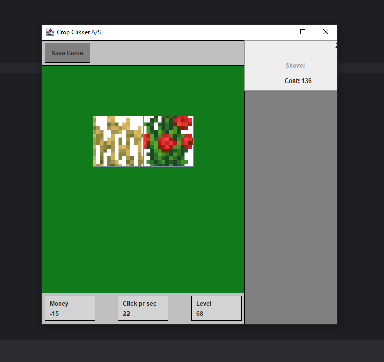

# 🌾 Side project "Crop Clicker A/S" 🌾

This project is created by 3 computer science students. The project is meant to be a fun challenge, and is souly created in our sparetime.

The game we are developing is scoped to be a clicker/tycoon game. User should be able to use the mouse to click certain items, buy upgrades, earn achievements and maybe more.

---

### 📝 Below here is a list of all known tasks 📝

- Map out level logic
  - Display next available upgrade when a certain mps has been reached (Or level)
- Implement level logic
- Button behavior (Map out expected button behavior)
- Add user friendly visuals regarding grow stages / info about it (Either text or png shown regarding stage of crop)
- Crop layout

---

### 🤓 Tasks that we are current working on 🤓

-

---

### 🐛 Known bugs 🐛

- When using macro, it is possible to go into minus balance! 
---

### ⭐ Features we want to implement at some point ⭐

- Growable stages that graduly increates yeild from crop
- Rebirth
- Implement achievements
- Create options window

---

### 🔗 Usefull links related to project 🔗

- [Mockup drawings](https://excalidraw.com/#json=1kRZQga_evZcjVHlAqrC2,vE0JO-MgsxpR0mjKnjJ1Cw)
